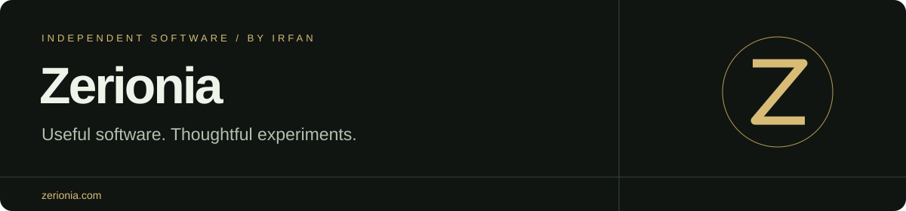

  

I'm **Irfan**, a software engineer building apps and tools at [Zerionia](https://zerionia.com). I explore AI, technology and gaming, test ideas, and turn useful ones into software you can try.

[Explore the studio](https://zerionia.com) · [Apps & downloads](https://zerionia.com/apps) · [Follow on X](https://x.com/ZerioniaHQ) · [Contact](mailto:contact@zerionia.com)

## Try Aegis

**Your PC, made clear.** A free, open-source PC monitor for Windows.

- A discreet in-game bar with CPU, GPU, RAM and available temperatures.
- Automatic recording for recognised games, session markers and comparisons.
- Local session storage, CSV exports and HTML reports.
- English and French included. No account or subscription.

**[Download for Windows →](https://zerionia.com/apps/aegis)**  
[Installation guide](https://zerionia.com/apps/aegis#installation) · [Source code](https://github.com/ZerionIA/aegis-pc) · [Report an issue](https://github.com/ZerionIA/aegis-pc/issues)

Aegis is currently in public beta. Sensor readings depend on hardware and permissions; see the installation guide for requirements and limitations.

## More from Zerionia

| Project | What it does | Try it |
| --- | --- | --- |
| **AI Chat Porter** | Turn exported AI conversations into Markdown files you can keep and search. | [Open the tool](https://zerionia.com/outils/chatgpt-export-to-markdown) |
| **WorldLiveView** | Explore public webcams, radio stations and destinations on an interactive globe. | [Discover the app](https://zerionia.com/apps/worldliveview) |
| **Zerionia Tools** | Practical web tools for everyday work. | [Browse tools](https://zerionia.com/outils) |

## Building in public

This profile brings together the public code and supporting resources behind my projects. For product updates, demos and experiments, find me on [X @ZerioniaHQ](https://x.com/ZerioniaHQ).

Questions or feedback? **[contact@zerionia.com](mailto:contact@zerionia.com)**
